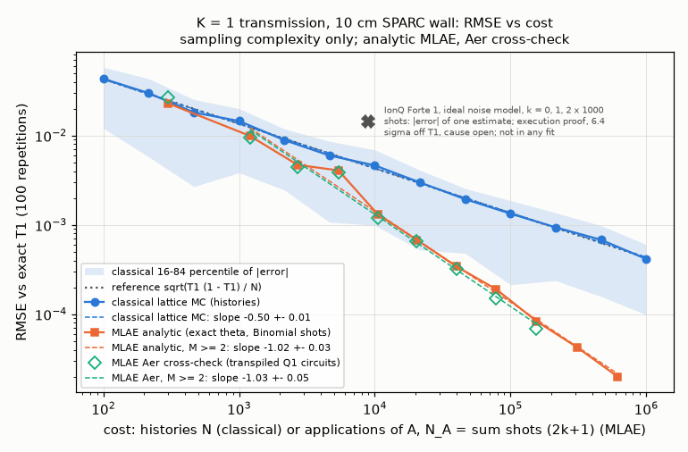
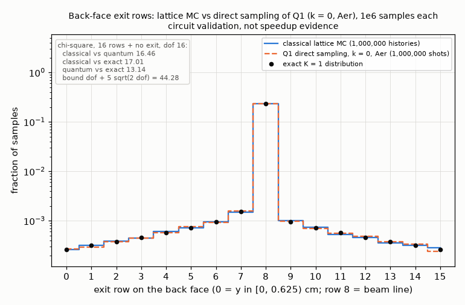
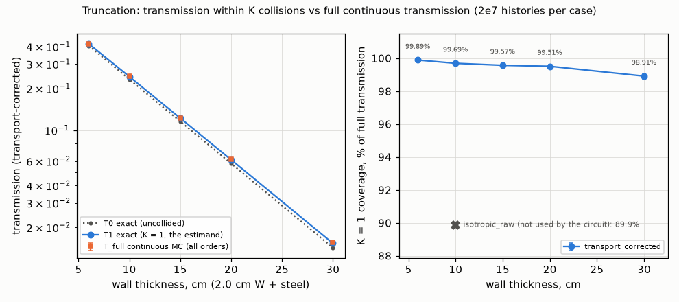
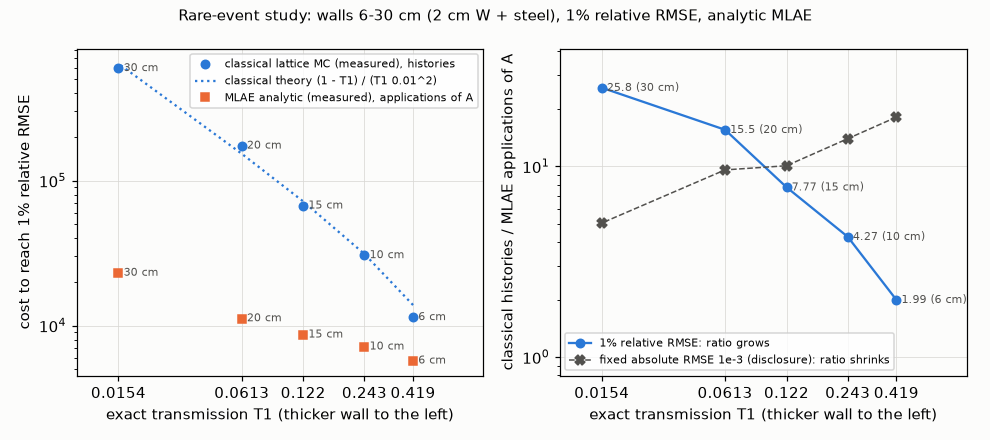

# Quantum Neutron Transport: SPARC First Wall

This project asks what fraction of 14 MeV fusion neutrons passes through a tungsten-armored steel first wall like the one in MIT/CFS's SPARC tokamak, and answers it twice: with a classical Monte Carlo and with quantum amplitude estimation (QAE) on a Qiskit circuit that encodes the same physics. Both estimate the same transmission fraction against the same exact answer, so the error of each method can be plotted against the number of samples it draws. Built for the Qollab x IonQ Hackathon, Quantum Impact theme.

This effort is supported by Qollab & IonQ.

Source code: https://github.com/hdelloye/quantum-neutron-transport-sparc. The live Qollab project and the demo video are linked from the Qollab project card.

## What it does

- **Problem.** It models 14.1 MeV neutrons crossing a 10 cm two-material wall (2 cm tungsten heavy alloy, 8 cm 316 stainless steel) with cited ENDF/B-VIII.0 cross sections, and asks for the transmission through the back face.
- **Classical baseline.** A continuous delta-tracking Monte Carlo is the physics reference, and a matched lattice Monte Carlo samples exactly the model the circuit encodes, so the two sides estimate the same quantity.
- **Quantum oracle plus MLAE.** A 12-qubit state preparation A encodes that lattice model, its flag probability is checked against the exact answer before any job, and maximum-likelihood amplitude estimation (MLAE) over Grover powers estimates it.
- **Headline comparison.** On an ideal simulator, the MLAE error falls with fitted slope -1.02 against cost, while the classical error falls with slope -0.50 (Results below).
- **Honest framing.** This is sampling complexity only. There is no wall-clock or quantum-advantage claim, and the IonQ runs are reported as an execution proof with their open discrepancy.

## The problem

About 80% of D-T fusion energy leaves the plasma as 14 MeV neutrons. How many of them cross the first wall sets the wall's damage rate, the tritium breeding in the blanket behind it and the shielding the superconducting magnets need. Today these numbers come from classical Monte Carlo codes such as MCNP and OpenMC, whose error falls as 1/sqrt(N) in the number of histories, and deep-penetration tallies are rare events that need many histories.

The model here:
- the SPARC first wall as a 10 cm x 10 cm slab on a 16 x 16 lattice: 2.0 cm of tungsten heavy alloy, then 8.0 cm of 316 stainless steel;
- a 14.1 MeV beam entering at mid-height, one energy group, transport-corrected ENDF/B-VIII.0 cross sections;
- the estimand is the K = 1 transmission: the probability that a neutron leaves through the back face after at most one collision. Its exact lattice value is T1 = 0.24300446519524305.

Physics, data sources and the frozen `Kernels` contract are in [docs/PHYSICS.md](docs/PHYSICS.md).

## Run it on Qollab

1. Use a browser that supports WebAssembly JSPI: a recent Chrome, Edge or Opera, or Firefox 153 or later. Qollab runs Python inside the browser, so other browsers cannot start the runtime.
2. Open the project page, keep **Select QPU** on `Built-in simulator` and leave the **Run settings** untouched. This is the judged path: it needs no account and runs entirely in your browser.
3. Press **Run**. The run takes a few seconds after the first matplotlib load.

The **Run settings** fields (every value is checked before any job is sent; an out-of-range value stops the run with an error and is never silently adjusted):
- `mode` (default `quick`): `quick`, `qae` or `smoke`.
- `k` (default 1): the Grover power for an IonQ run, an integer from 0 to 8. IonQ only.
- `shots` (default 1000): an integer from 2 to 10,000; the number of shots per Grover power on the Built-in simulator, or of the single circuit on IonQ.
- `ideal_mode` (default `set_options`): `set_options` sets IonQ's `noise_model="ideal"` first, so the counts are real samples. `none` is refused in `quick` and `qae` modes (Phase 4 review CR-01): IonQ noise-model counts are rounded probabilities that do not sum to shots, so the run's record would be lost. `smoke` mode also accepts `none` and `kwarg`. IonQ only.
- `model` (default `Q1`): `Q1` (12 qubits), `Q1lite` (8 qubits, the IonQ size fallback) or `Q0` (5 qubits, no collision).

**Quick mode** (the default) prints, in order:
1. the contract line: the circuit's flag probability against the exact T1, within 1e-12;
2. a `QUICK MLAE a_hat=... N_A=... schedule=[0, 1, 2] shots/power=...` line: one live job over Grover powers k = 0, 1, 2 with `shots` each, so N_A = 9 x shots applications of A;
3. the IonQ line, rebuilt from the committed records in `data/ionq_runs.json` and always carrying its caveat:
   ```text
   IonQ Forte 1 records (ideal, sampled): k=[0, 1, 2] -> a_hat=0.228671, |a_hat - T1|=1.43e-02, se=2.24e-03, z=-6.38, N_A=9000. CAVEAT: execution proof only, not in any fit or claim; 6.4 sigma from exact T1; the k >= 1 records deviate beyond shot noise, cause open (docs/QUANTUM.md)
   ```
4. the four Phase 5 figures, rendered from `data/*.json`; each appears in the console and is offered as a PNG download (`figure i/4 <kind>: shown (download quick_fig_<name>.png)`);
5. one `QUICK_REPORT=` line (JSON with the live result, the IonQ summary and the figure status);
6. `QUICK MODE OK`, or `QUICK MODE INCOMPLETE: live run <ok|failed>, <n> of 4 figures rendered` if a part failed.

Other modes:
- `mode = qae` runs the Phase 4 amplitude estimation over k = 0, 1, 2, 4: a `QAE_REPORT=` line, an `MLAE a_hat=...` line, the IonQ line with its caveat, then `QAE RUN COMPLETED`.
- `mode = smoke` reproduces the Phase 1 runtime check: one `QOLLAB_RUNTIME_REPORT=` line, then `SMOKE TEST PASSED`.
- **IonQ** (`IonQ Forte 1` in Select QPU) needs a signed-in account. Qollab allows one job per run and its IonQ proxy accepts one circuit per job, so in `quick` and `qae` modes an IonQ run sends exactly one circuit, A followed by k Grover steps. It prints one `IONQ_RECORD=` line (JSON with the counts and resources) and ends with `IONQ RUN ACCEPTED`, or `IONQ RUN FAILED: <error>`. The IonQ estimate is assembled from separate runs at k = 0, 1 and 2; see [docs/QUANTUM.md](docs/QUANTUM.md).

## Run it locally

You need Python 3.14.

```bash
python3.14 -m venv .venv
.venv/bin/python -m pip install -r requirements.txt pytest
.venv/bin/python scripts/run_local.py                        # quick mode, as on Qollab; ends with QUICK MODE OK
.venv/bin/python scripts/run_local.py --seed 2026 --figure-dir /tmp/q   # reproducible; PNGs into /tmp/q
.venv/bin/python scripts/run_local.py --mode qae --seed 2026 # the Phase 4 QAE run; ends with QAE RUN COMPLETED
.venv/bin/python scripts/run_local.py --mode smoke           # prints SMOKE TEST PASSED
```

- `scripts/run_local.py` injects a backend the way Qollab does and prints where the quick-mode figures went (a fresh temporary directory unless `--figure-dir DIR` is given; never the repository).
- `--mode`, `--k`, `--shots`, `--ideal-mode` and `--model` set the matching Run settings fields; fields you leave out keep `main()`'s defaults. `--seed N` makes the counts reproducible.
- `--backend aer` runs the same `main.py` on Aer; `--backend fake-ionq` exercises the IonQ one-circuit path with a local test double.
- `.venv/bin/python -m pip install -e ".[dev]"` adds qiskit-aer, qiskit-algorithms and ruff.

Tests:

```bash
.venv/bin/python -m pytest -q                                  # default suite, under 30 s
NEUTRON_QAE_SLOW=1 .venv/bin/python -m pytest -q -m slow       # slow checks (figure re-render, full quick run)
```

Keep calling tools as `.venv/bin/python -m pip` and `.venv/bin/python -m pytest`: if the checkout path contains spaces, the console-script shebangs inside the venv can break, while `python -m` always works.

## Replicate the results

Every committed result comes from one local script run with seed 2026 from a clean tree; each JSON records the commit, the command line, library versions and timings, so reruns reproduce the committed files. Times are measured on an Apple Silicon Mac with Python 3.14.

- **RMSE versus cost** (`data/scaling_rmse.json`): `.venv/bin/python scripts/sweep_scaling.py --seed 2026`, about 71 s (analytic MLAE 45 s, Aer 20 s).
- **Exit histograms** (`data/exit_histograms.json`): `.venv/bin/python scripts/sweep_histograms.py --seed 2026`, about 1.3 s.
- **Truncation bias** (`data/truncation_bias.json`): `.venv/bin/python scripts/sweep_truncation.py --seed 2026`, about 11 s.
- **Wall thickness** (`data/thickness_study.json`): `.venv/bin/python scripts/sweep_thickness.py --seed 2026`, about 75 s.
- **Figures**: `.venv/bin/python scripts/render_figures.py` re-renders the four PNGs from the JSON; `--check` compares fresh renders with the committed PNGs and prints `RENDER CHECK OK 4`.
- **Kernels contract**: `.venv/bin/python scripts/freeze_kernels.py` rebuilds the contract and compares it with `tests/golden/kernels_v1.json` (`GOLDEN OK`).
- **IonQ records**: save the Qollab console output of each IonQ run to a text file and run `.venv/bin/python scripts/ingest_ionq_records.py PASTE`; it validates the records and stores them verbatim in `data/ionq_runs.json`.
- **Resources**: `.venv/bin/python scripts/qae_local.py resources` prints the circuit resource table.

For a seconds-long smoke run of any sweep add `--profile quick --out-dir <scratch directory>`; quick output never overwrites the committed files. Tables, reading notes and limits: [docs/RESULTS.md](docs/RESULTS.md).

## Results



The figure plots the root-mean-square error of 100 independent estimates against cost: histories for the classical lattice Monte Carlo, applications of A for MLAE. Both estimate the same K = 1 transmission of the 10 cm wall, and the exact value T1 = 0.24300446519524305 is the truth. Monte Carlo should fall with slope -0.5 on this log-log plot, ideal amplitude estimation with slope -1.

Fitted slopes: -0.50 +- 0.01 (classical lattice MC, 13 points), -1.02 +- 0.03 (MLAE, analytic runner, M = 2..11), -1.03 +- 0.05 (MLAE, Aer circuit simulation, M = 2..9).

The +- values are the residual scatter of a least-squares fit over nested points (fit scatter), not sampling standard errors of the slopes.

- **Aer cross-check.** Simulating the transpiled Q1 circuits on Aer gives the same curve as the analytic runner: the RMSE stays within about 0.8 to 1.2 times the analytic value at every point, and the two fitted slopes are -1.02 and -1.03.
- **Exit histograms (circuit validation, not speedup evidence).** 1,000,000 matched samples of the classical engine and of the circuit A agree by chi-square (16.46 on 16 degrees of freedom, bound 44.28): the circuit encodes the same physics. Direct sampling of A converges like classical Monte Carlo, so this figure carries no speedup claim.

  
- **Truncation.** The K = 1 quantity both methods estimate covers about 99.7% of the full 10 cm transmission computed with all collision orders, and about 98.9% at 30 cm.

  
- **Wall thickness.** At 1% relative RMSE the classical-to-MLAE cost ratio grows from 1.99 (6 cm) to 25.84 (30 cm) as transmission becomes rarer. At a fixed absolute RMSE of 1e-3 the ratio shrinks instead, from 18.10 to 5.04; both are reported.

  
- **IonQ.** The IonQ Forte 1 point on the figure is one estimate's error: an execution proof of the real circuits, 6.4 sigma off T1 with the cause open, not in any fit.
- **What this shows.** Sampling complexity on an ideal simulator only: error against the number of samples. It is not a wall-clock or quantum-advantage claim.

Tables, reading notes, reproduction commands and limits: [docs/RESULTS.md](docs/RESULTS.md).

## Judging criteria

### Novelty

Prior art. Olivier & Nowak (arXiv:2410.19489, 2024) model particle transport through 2D shielding with a quantum walk, in emulation only and without amplitude estimation. Lee, Lee & Kim (Phys. Rev. D 111, 116001, 2025; arXiv:2502.14374) combine a quantum walk with QAE for 10 MeV photon transport on the Qiskit simulator. Miao, Jin & Sone (arXiv:2607.10772, 2026) apply QAE to two nuclear-engineering expectation values, with no transport.

To our knowledge, this is the first end-to-end QAE estimate of a neutron transport tally through a two-material fusion first wall, with measured error-versus-oracle-query scaling against a matched classical baseline.

The comparison behind that claim is sampling complexity on an ideal simulator: estimation error against the number of samples each method draws, nothing more.

### Technical execution

- **Contract gate.** Before any job, the circuit's flag probability must equal the exact lattice answer T1 = 0.24300446519524305 within 1e-12; otherwise the run stops.
- **Frozen physics contract.** Classical and quantum code read physics only through the frozen `Kernels` contract v1 (`KERNELS_CONTRACT_VERSION = "1"`, values frozen in `tests/golden/`), so both sides cannot drift apart.
- **Two classical engines.** A continuous Woodcock delta-tracking Monte Carlo is the physics reference; the matched lattice Monte Carlo is the baseline, drawing from an injected random source.
- **One circuit, transpiled once.** Q1 gives each random choice (first-collision column, scatter or absorb, direction bin, escape) its own register and one flag qubit marks transmission. Its Grover powers are transpiled once to an IonQ-safe basis with at most one control per gate:

  | Circuit | Qubits | CX |
  |---|---|---|
  | A | 12 | 313 |
  | A·Q^1 | 12 | 1,503 |
  | A·Q^2 | 12 | 2,693 |

  All stay within 24 qubits. Details: [docs/QUANTUM.md](docs/QUANTUM.md).
- **MLAE.** A vendored maximum-likelihood estimator (checked against qiskit-algorithms in the tests) combines the counts of several Grover powers into one estimate with a Fisher standard error. Its cost is N_A = sum of shots x (2k + 1), the number of applications of A, the same unit as one classical history.
- **Validation.** Aer simulation of the transpiled circuits reproduces the analytic runner's error curve, and a chi-square test on 1,000,000 matched samples shows the circuit's exit-row histogram matches the classical engine.
- **IonQ execution.** Three IonQ Forte 1 runs on Qollab (k = 0, 1, 2; 1000 shots each; ideal, sampled; one circuit per run) were accepted and stored verbatim in `data/ionq_runs.json` from their `IONQ_RECORD=` lines. Their estimate a_hat = 0.228671 is 6.4 sigma below T1, with the cause open. The circuits Qollab's browser transpiled and sent had 556 / 3016 / 5476 gates against 555 / 3013 / 5471 for the local transpile, one extra gate per application of A; they were not simulated locally, so the local statevector check covers the locally transpiled circuit only.
- **In-browser run.** The Built-in simulator path runs the contract check, a live MLAE and the four figures in the judge's browser, logged out (`QUICK MODE OK`; the `qae` mode ends with `QAE RUN COMPLETED`).
- **Tests and compliance.** About 400 pytest tests run in under 30 s; `tests/test_compliance.py` enforces the Qollab rules below on every run, and the docs tests keep these pages in step with the code and data.

### Impact

Shielding, blanket and magnet-protection design in fusion devices depend on deep-penetration transmission tallies, which are rare events for classical Monte Carlo. The wall-thickness study shows how the comparison moves as transmission gets rarer: at 1% relative RMSE the classical-to-MLAE cost ratio grows from 1.99 (6 cm) to 25.84 (30 cm), while at a fixed absolute RMSE of 1e-3 it shrinks from 18.10 to 5.04; both are reported.

Production Monte Carlo codes use variance reduction (weight windows, implicit capture) that the analog baseline here does not, so these ratios are a sampling-complexity trend on a matched analog baseline, not a deployment claim. The value of the project is a complete, tested pipeline from cited nuclear data to a contract-checked circuit, a matched baseline and measured scaling, which teammates can extend (see [HANDOFF.md](HANDOFF.md)).

### Documentation

- this README (also the Qollab write-up);
- [docs/PHYSICS.md](docs/PHYSICS.md): geometry, cited cross sections, the one-group model and the `Kernels` contract;
- [docs/QUANTUM.md](docs/QUANTUM.md): register layout, resources, MLAE, the IonQ protocol and results;
- [docs/RESULTS.md](docs/RESULTS.md): the Phase 5 tables, generated from `data/` and checked by tests;
- [docs/QOLLAB-RUNTIME.md](docs/QOLLAB-RUNTIME.md): measured facts about the Qollab runtime, with verbatim console lines;
- [HANDOFF.md](HANDOFF.md): module owners, test commands, the contract and what is left;
- the tests under `tests/` and the disclosure section below.

## Limitations

- **One-group physics.** One 14.1 MeV energy group with transport-corrected cross sections; (n,2n) is counted as removal, and there is no energy spectrum and no secondary particles. See [docs/PHYSICS.md](docs/PHYSICS.md).
- **K-collision truncation.** The estimand is the transmission within K = 1 collision. Under the transport-corrected model it covers about 99.7% of the full 10 cm transmission (89.9% under `isotropic_raw`, a model-dependence disclosure only).
- **Ideal-simulator scaling plot.** The RMSE-versus-cost curves come from the analytic runner and from Aer simulation of the transpiled circuits, not from hardware or a noisy simulator.
- **Noise on IonQ simulators.** Qollab's IonQ simulators apply a noise model by default. With about 1.5k two-qubit gates at k = 1, noise is expected to wash out the amplification. `main.py` refuses noise-model runs (`ideal_mode = none`, Phase 4 review CR-01), and none was ever used for statistics.
- **Open IonQ ideal-simulator discrepancy.** The three ideal, sampled IonQ Forte 1 runs give a_hat = 0.228671, 6.4 sigma below T1; the k = 1 and k = 2 points deviate beyond shot noise. The circuits Qollab's browser transpiled and sent differ from the local transpile by one gate per application of A, and they were not simulated locally. The cause is open.
- **No wall-clock speedup claim.** There is no wall-clock speedup claim: a lattice history costs well under a microsecond here, while one application of A costs a full circuit execution.
- **Sampling-complexity argument only.** The comparison is error against applications of A: about 1/N_A for MLAE against 1/sqrt(N) for classical Monte Carlo. Transpilation, circuit depth and the gate cost of state preparation are not part of it.

## Repository layout

```text
main.py            Qollab entry point; main(...) reads the backend Qollab injects (modes quick, qae, smoke)
requirements.txt   Qollab-facing dependencies (only qiskit==2.5.2)
pyproject.toml     local install, dev extras and pytest config (not used by Qollab)
LICENSE            MIT license
README.md          this file; also the Qollab project write-up
HANDOFF.md         teammate handoff: owners, tests, contract, remaining work (GitHub only)
neutron_qae/       the Python package:
  smoke.py         Phase 1 Qollab smoke test (main.py mode=smoke)
  nuclear_data.py  cited 14.1 MeV ENDF/B-VIII.0 cross sections and material compositions
  problem.py       ProblemSpec: the SPARC first-wall slab, geometry and one-group materials
  kernels.py       frozen Kernels contract v1 shared by the classical and quantum engines
  exact.py         exact lattice solver (literal bit-string enumeration, T0 and T1)
  random_source.py the injected random source every Monte Carlo engine draws from
  mc_continuous.py continuous Woodcock delta-tracking Monte Carlo (physics reference)
  mc_lattice.py    matched discrete lattice Monte Carlo (the classical baseline)
  oracle.py        quantum state preparation A for Q0, Q1 and Q1lite, behind the contract gate
  grover.py        Grover powers A·Q^k, transpiled once to an IonQ-safe basis; resource table
  mlae.py          maximum-likelihood amplitude estimation and the cost N_A
  runners.py       analytic, injected-backend and IonQ one-circuit runners; IonQ record schema
  artifacts.py     result artifacts: literal data/ paths, schema validation, Markdown tables (stdlib only)
  analysis.py      RMSE series, log-log fits, cost at a target, chi-square and histogram helpers
  figures.py       matplotlib figures rendered from the artifact JSON (quick mode and render_figures.py)
data/              small data files loaded by literal path (each at most 2 MB)
  smoke_probe.json Phase 1 literal-path probe
  ionq_runs.json   IonQ records ingested from Qollab console output
  scaling_rmse.json, fig_scaling_rmse.png          RMSE versus cost (headline)
  exit_histograms.json, fig_exit_histograms.png    exit-position histograms (circuit validation)
  truncation_bias.json, fig_truncation_bias.png    K = 1 truncation bias per wall and model
  thickness_study.json, fig_thickness_ratio.png    wall-thickness cost ratio
scripts/           local-only tools: run_local.py (injects a simulator like Qollab), qae_local.py
                   (resource table, local estimates), ingest_ionq_records.py (paste -> data/ionq_runs.json),
                   sweep_scaling.py, sweep_histograms.py, sweep_truncation.py, sweep_thickness.py (Phase 5
                   sweeps), sweep_common.py (shared sweep helpers), render_figures.py (PNGs from the JSON),
                   freeze_kernels.py (the only writer of the golden contract), derive_cross_sections.py
tests/             pytest suite: compliance gates, smoke test, physics, contract, quantum and docs checks
  golden/          frozen contract values (tests/golden/kernels_v1.json)
docs/              project records: QOLLAB-RUNTIME.md, PHYSICS.md, QUANTUM.md, RESULTS.md
```

`.gitattributes` marks `.planning/`, `docs/`, `tests/`, `scripts/` and `HANDOFF.md` as export-ignore, so `git archive` produces exactly the 30 files Qollab needs.

## Rules every module follows

- The backend is injected by Qollab (or by `scripts/run_local.py`) and passed into package functions as a parameter. Package code never creates a backend.
- Nothing reachable from `main.py` imports qiskit-aer, qiskit-algorithms or qiskit-ionq. Those packages are not installed for every Qollab backend choice.
- Data files stay at or under 2 MB and are referenced by literal path strings in the code, because Qollab only loads data files whose path appears as a literal.
- The `main()` signature stays on one line, with `int`, `float`, `str` or `bool` parameters and literal defaults, so Qollab can build the Run settings form. `main.py` never calls `main()` itself; Qollab does.
- One job per run and one circuit per job on Qollab's IonQ backends: Qollab allows a single `backend.run` call per run and its IonQ proxy accepts only job type `ionq.circuit.v1`, so the circuit is passed to `backend.run` on its own, never in a list (qiskit-ionq sends any list as `ionq.multi-circuit.v1`, which Qollab rejects).
- `tests/test_compliance.py` enforces these rules on every test run.
- Physics enters classical and quantum code only through the frozen `Kernels` contract (`neutron_qae/kernels.py`, `KERNELS_CONTRACT_VERSION = "1"`, values frozen in `tests/golden/kernels_v1.json`). Import it; never rebuild private tables. Changing it is a contract change, described in docs/PHYSICS.md. `tests/test_kernels_golden.py` checks the freeze on every test run.

## Libraries, tools and licenses (disclosure)

| Component | Version | How we use it | License |
|-----------|---------|---------------|---------|
| Qiskit | 2.5.2 | Circuits, transpilation, BasicSimulator | Apache-2.0 |
| qiskit-ionq | 1.0.2 on Qollab (1.1.1 locally) | IonQ simulator backend provided by Qollab's runtime | Apache-2.0 |
| NumPy | Pyodide build on Qollab (2.x) | Numerics | BSD-3-Clause (bundled parts: 0BSD, MIT, Zlib, CC0-1.0) |
| SciPy / Matplotlib | Pyodide builds (Matplotlib 3.11.2 locally) | SciPy: optional numerics; Matplotlib: the figures in data/ | BSD-3-Clause / Matplotlib License (PSF-based) |
| qiskit-aer, qiskit-algorithms | 0.17.2, 0.4.0 | Local tests and precomputation only; never run on Qollab | Apache-2.0 |
| pytest, ruff | 9.1.1, 0.16.10 | Testing, linting | MIT |
| Pyodide | 314.0.7 | Qollab's in-browser Python runtime (not redistributed by us) | MPL-2.0 |
| Claude Code (Anthropic) | hosted service (Claude Opus and Sonnet models) | AI coding assistant for research, planning, code and docs drafting, reviewed by the team | Anthropic usage terms; Anthropic assigns its rights in outputs to the user |
| GSD Core (@opengsd/gsd-core) | 1.16.0 | AI workflow framework driving research, planning and execution | MIT |

All third-party libraries are used under their open-source licenses, which permit use in an MIT-licensed project with their notices kept, so the team may use them. No third-party source code is copied into this repository; if any is vendored later, it keeps its license header and is listed here. The hackathon rules allow AI tools and open-source libraries when they are disclosed, and this section is that disclosure.

## License

MIT. See [LICENSE](LICENSE).
